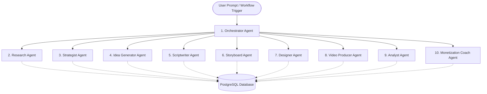

# AI AGENT SPECIFICATION — CREATOROS AI

## 1. AGENT ARCHITECTURE & GOVERNANCE PRINCIPLES

CreatorOS AI deploys a structured, deterministic multi-agent system.
- **No Agent Chatter:** Agents communicate via strictly validated typed contracts, not unstructured conversations.
- **Orchestrator Control:** The Orchestrator Agent coordinates execution DAGs (Directed Acyclic Graphs) and state transitions.
- **Deterministic Validation:** All LLM outputs must satisfy Zod schemas before being persisted to the database.
- **Human-in-the-Loop (HITL):** High-impact actions (publishing schedules, batch asset generation, subscription modifications) require explicit user approval.
- **Hard Cost Limits:** Each agent has a maximum token and execution budget per invocation.



---

## 2. SPECIALIZED AGENT SPECIFICATIONS

### 2.1 Orchestrator Agent
- **Purpose:** Analyzes user intent, verifies workspace credits, determines workflow stages, and dispatches tasks to specialized sub-agents.
- **Context Requirements:** Active workspace ID, Creator Mode, user permissions, available credits.
- **Input Schema:**
  ```typescript
  {
    workspaceId: string;
    trigger: "onboarding" | "create_content" | "weekly_strategy" | "custom_prompt";
    parameters: Record<string, unknown>;
  }
  ```
- **Output Schema:**
  ```typescript
  {
    planId: string;
    steps: Array<{ stepIndex: number; agent: string; status: "pending" | "executing" | "completed" | "failed" }>;
    estimatedCredits: number;
  }
  ```
- **Budget & Guardrails:** Max 2,000 prompt tokens, 500 completion tokens. No direct generation tools.

---

### 2.2 Research Agent
- **Purpose:** Conducts verified market, competitor, and trend research without inventing unverified statistics.
- **Context Requirements:** Niche, platform, target audience, topic query.
- **Available Tools:** Search API / Perplexity / Google Search Tool, Competitor Analyzer.
- **Input Schema:**
  ```typescript
  {
    niche: string;
    topicQuery: string;
    platforms: Array<"tiktok" | "instagram" | "youtube" | "linkedin">;
    language: "id" | "en";
  }
  ```
- **Output Schema:**
  ```typescript
  {
    summary: string;
    trendingHooks: string[];
    audiencePainPoints: string[];
    contentOpportunities: Array<{ topic: string; demandLevel: "high" | "medium"; competitionLevel: "low" | "medium" | "high" }>;
    verifiedCitations: Array<{ title: string; url: string; excerpt: string }>;
  }
  ```
- **Budget & Guardrails:** Max 4,000 prompt tokens, 1,500 completion tokens. Enforce non-hallucination citation rule.

---

### 2.3 Strategist Agent
- **Purpose:** Formulates content pillars, publishing cadence, and multi-week thematic campaign roadmaps.
- **Context Requirements:** Creator DNA, audience persona, research reports, historical content performance.
- **Input Schema:**
  ```typescript
  {
    creatorDna: { niche: string; tone: string[]; archetype: string };
    researchReportId?: string;
    timeframeWeeks: number;
    weeklyCadence: number;
  }
  ```
- **Output Schema:**
  ```typescript
  {
    strategyTitle: string;
    pillars: Array<{ name: string; description: string; ratioPercentage: number; exampleTopics: string[] }>;
    weeklySchedule: Array<{ dayOfWeek: number; recommendedPillar: string; format: string }>;
  }
  ```
- **Budget & Guardrails:** Max 4,000 prompt tokens, 2,000 completion tokens.

---

### 2.4 Idea Generator Agent
- **Purpose:** Produces creative content angles categorized by psychological triggers (Curiosity, Contrarian, Step-by-Step, Story).
- **Context Requirements:** Content pillar, recent high-performing competitor hooks, platform guidelines.
- **Input Schema:**
  ```typescript
  {
    pillarName: string;
    count: number;
    platform: "tiktok" | "instagram" | "youtube" | "linkedin";
    creatorTone: string[];
  }
  ```
- **Output Schema:**
  ```typescript
  {
    ideas: Array<{
      title: string;
      hookAngle: "curiosity" | "contrarian" | "tutorial" | "case_study" | "relatable";
      hookPreview: string;
      targetEmotion: string;
      estimatedPotentialScore: number;
    }>;
  }
  ```
- **Budget & Guardrails:** Max 3,000 prompt tokens, 1,500 completion tokens.

---

### 2.5 Scriptwriter Agent
- **Purpose:** Generates high-retention scripts optimized for short-form or long-form video with exact pacing and audio cues.
- **Context Requirements:** Selected idea, Creator DNA, platform constraints (e.g., 30s TikTok vs. 10m YouTube), framework (AIDA, PAS).
- **Input Schema:**
  ```typescript
  {
    ideaTitle: string;
    hookAngle: string;
    platform: "tiktok" | "instagram" | "youtube";
    targetDurationSeconds: number;
    framework: "AIDA" | "PAS" | "BAB" | "Story";
    creatorPersona: { tone: string[]; language: "id" | "en" };
  }
  ```
- **Output Schema:**
  ```typescript
  {
    openingHook: string;
    bodyContent: string;
    closingCta: string;
    caption: string;
    hashtags: string[];
    estimatedDurationSeconds: number;
    wordCount: number;
  }
  ```
- **Budget & Guardrails:** Max 4,000 prompt tokens, 2,500 completion tokens.

---

### 2.6 Storyboard Agent
- **Purpose:** Converts scripts into detailed, actionable visual direction and scene-by-scene shoot plans.
- **Context Requirements:** Approved script, visual branding theme, target video format.
- **Input Schema:**
  ```typescript
  {
    scriptId: string;
    fullScriptText: string;
    aspectRatio: "9:16" | "16:9" | "1:1";
  }
  ```
- **Output Schema:**
  ```typescript
  {
    scenes: Array<{
      sceneNumber: number;
      durationSeconds: number;
      spokenText: string;
      visualDescription: string;
      cameraAngle: "close-up" | "medium-shot" | "wide-shot" | "pov" | "screen-record";
      onScreenText: string;
      audioCue: string;
    }>;
  }
  ```
- **Budget & Guardrails:** Max 4,000 prompt tokens, 2,000 completion tokens.

---

### 2.7 Designer Agent
- **Purpose:** Generates visual prompts and parameters for thumbnail design, cover art, and carousel graphics.
- **Context Requirements:** Storyboard, Brand Profile (color palette, typography), platform dimension specs.
- **Input Schema:**
  ```typescript
  {
    title: string;
    visualTheme: string;
    palette: { primary: string; secondary: string };
    assetType: "thumbnail" | "carousel_slide" | "story_cover";
  }
  ```
- **Output Schema:**
  ```typescript
  {
    suggestedHeadline: string;
    imagePrompt: string;
    negativePrompt: string;
    layoutGuidelines: string;
    recommendedDimensions: { width: number; height: number };
  }
  ```
- **Budget & Guardrails:** Max 2,000 prompt tokens, 1,000 completion tokens.

---

### 2.8 Video Producer Agent
- **Purpose:** Coordinates media asset generation (image models, ElevenLabs speech synthesis, FFmpeg stitching jobs via Inngest).
- **Context Requirements:** Storyboard scenes, voiceover parameters, background music track selection.
- **Input Schema:**
  ```typescript
  {
    storyboardId: string;
    voiceId: string;
    language: "id" | "en";
    generateVideoPreviews: boolean;
  }
  ```
- **Output Schema:**
  ```typescript
  {
    mediaJobId: string;
    audioAssetUrls: string[];
    status: "dispatched" | "processing";
  }
  ```
- **Budget & Guardrails:** Deterministic dispatch only. Token limit: 1,500 tokens.

---

### 2.9 Analyst Agent
- **Purpose:** Diagnoses post-publishing metrics, computes hook retention drop-offs, and suggests iterative improvements.
- **Context Requirements:** Analytics snapshots, script history, platform benchmarks.
- **Input Schema:**
  ```typescript
  {
    contentItemId: string;
    metrics: { views: number; likes: number; comments: number; shares: number; watchTimeSeconds: number };
  }
  ```
- **Output Schema:**
  ```typescript
  {
    performanceGrade: "A" | "B" | "C" | "D";
    keyStrengths: string[];
    dropOffAnalysis: string;
    iterativeRecommendations: string[];
  }
  ```
- **Budget & Guardrails:** Max 3,000 prompt tokens, 1,200 completion tokens.

---

### 2.10 Monetization Coach Agent
- **Purpose:** Analyzes Creator DNA and audience engagement to recommend affiliate products, digital product funnels, and brand sponsorship pricing.
- **Context Requirements:** Creator profile, audience demographics, niche monetization benchmarks.
- **Input Schema:**
  ```typescript
  {
    workspaceId: string;
    creatorMode: "affiliate" | "creator" | "business" | "personal_brand";
    currentFollowers: number;
    avgViewsPerPost: number;
  }
  ```
- **Output Schema:**
  ```typescript
  {
    monetizationPotentialScore: number;
    recommendedAffiliateCategories: string[];
    digitalProductIdeas: Array<{ title: string; format: "ebook" | "notion_template" | "mini_course"; targetPriceIdr: number }>;
    estimatedSponsorshipRateIdr: { min: number; max: number };
  }
  ```
- **Budget & Guardrails:** Max 3,500 prompt tokens, 1,500 completion tokens.
