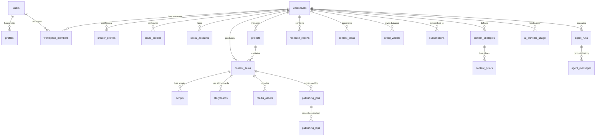

# DATABASE SCHEMA SPECIFICATION — CREATOROS AI

**Database Engine:** PostgreSQL 15+ (Hosted on Supabase)  
**Tenancy Model:** Multi-Tenant via `workspaces` table  
**Security Model:** Mandatory PostgreSQL Row Level Security (RLS) on all user-facing tables  
**Primary Key Convention:** UUID v4 (`gen_random_uuid()`)  
**Timestamp Standard:** UTC `TIMESTAMPTZ` with `DEFAULT NOW()`  

---

## 1. ENTITY RELATIONSHIP OVERVIEW



---

## 2. CORE TABLE DEFINITIONS

### 2.1 Workspace & User Management

```sql
-- 1. profiles: Extends auth.users
CREATE TABLE profiles (
    id UUID PRIMARY KEY REFERENCES auth.users(id) ON DELETE CASCADE,
    full_name TEXT NOT NULL,
    avatar_url TEXT,
    preferred_language VARCHAR(10) DEFAULT 'id', -- 'id' | 'en'
    theme_preference VARCHAR(10) DEFAULT 'system', -- 'dark' | 'light' | 'system'
    onboarding_completed BOOLEAN DEFAULT FALSE,
    created_at TIMESTAMPTZ DEFAULT NOW() NOT NULL,
    updated_at TIMESTAMPTZ DEFAULT NOW() NOT NULL
);

-- 2. workspaces: Multi-tenant root entity
CREATE TABLE workspaces (
    id UUID PRIMARY KEY DEFAULT gen_random_uuid(),
    name TEXT NOT NULL,
    slug TEXT NOT NULL UNIQUE,
    creator_mode VARCHAR(30) DEFAULT 'creator' NOT NULL, -- 'creator' | 'affiliate' | 'business' | 'personal_brand'
    logo_url TEXT,
    created_by UUID REFERENCES profiles(id) ON DELETE RESTRICT NOT NULL,
    created_at TIMESTAMPTZ DEFAULT NOW() NOT NULL,
    updated_at TIMESTAMPTZ DEFAULT NOW() NOT NULL,
    deleted_at TIMESTAMPTZ
);

-- 3. workspace_members: Membership & RBAC
CREATE TABLE workspace_members (
    id UUID PRIMARY KEY DEFAULT gen_random_uuid(),
    workspace_id UUID REFERENCES workspaces(id) ON DELETE CASCADE NOT NULL,
    user_id UUID REFERENCES profiles(id) ON DELETE CASCADE NOT NULL,
    role VARCHAR(20) DEFAULT 'member' NOT NULL, -- 'owner' | 'admin' | 'editor' | 'viewer'
    created_at TIMESTAMPTZ DEFAULT NOW() NOT NULL,
    updated_at TIMESTAMPTZ DEFAULT NOW() NOT NULL,
    UNIQUE(workspace_id, user_id)
);
```

### 2.2 Creator Intelligence & Brand

```sql
-- 4. creator_profiles: The synthesized Creator DNA
CREATE TABLE creator_profiles (
    id UUID PRIMARY KEY DEFAULT gen_random_uuid(),
    workspace_id UUID REFERENCES workspaces(id) ON DELETE CASCADE NOT NULL UNIQUE,
    creator_name TEXT NOT NULL,
    primary_niche TEXT NOT NULL,
    secondary_niches TEXT[] DEFAULT '{}',
    target_audience_summary TEXT,
    tone_of_voice TEXT[], -- e.g. ['humorous', 'educational', 'provocative']
    personality_archetype TEXT, -- e.g. 'The Explorer', 'The Expert'
    strengths TEXT[],
    taboo_topics TEXT[],
    primary_platforms VARCHAR(30)[] DEFAULT '{tiktok,instagram}',
    assessment_scores JSONB DEFAULT '{}', -- e.g. { "consistency": 8, "storytelling": 6 }
    roadmap_30_days JSONB DEFAULT '[]',
    created_at TIMESTAMPTZ DEFAULT NOW() NOT NULL,
    updated_at TIMESTAMPTZ DEFAULT NOW() NOT NULL
);

-- 5. brand_profiles: For Business & Affiliate Modes
CREATE TABLE brand_profiles (
    id UUID PRIMARY KEY DEFAULT gen_random_uuid(),
    workspace_id UUID REFERENCES workspaces(id) ON DELETE CASCADE NOT NULL,
    brand_name TEXT NOT NULL,
    tagline TEXT,
    mission_statement TEXT,
    brand_values TEXT[],
    target_customer_persona JSONB DEFAULT '{}',
    color_palette JSONB DEFAULT '{"primary": "#4F46E5", "secondary": "#06B6D4"}',
    typography JSONB DEFAULT '{"heading": "Inter", "body": "Inter"}',
    created_at TIMESTAMPTZ DEFAULT NOW() NOT NULL,
    updated_at TIMESTAMPTZ DEFAULT NOW() NOT NULL
);

-- 6. social_accounts: Connected publisher credentials
CREATE TABLE social_accounts (
    id UUID PRIMARY KEY DEFAULT gen_random_uuid(),
    workspace_id UUID REFERENCES workspaces(id) ON DELETE CASCADE NOT NULL,
    platform VARCHAR(30) NOT NULL, -- 'tiktok' | 'instagram' | 'youtube' | 'linkedin'
    account_handle TEXT NOT NULL,
    account_name TEXT,
    account_id TEXT NOT NULL,
    encrypted_access_token TEXT NOT NULL,
    encrypted_refresh_token TEXT,
    token_expires_at TIMESTAMPTZ,
    status VARCHAR(20) DEFAULT 'active' NOT NULL, -- 'active' | 'expired' | 'revoked'
    created_at TIMESTAMPTZ DEFAULT NOW() NOT NULL,
    updated_at TIMESTAMPTZ DEFAULT NOW() NOT NULL,
    UNIQUE(workspace_id, platform, account_id)
);
```

### 2.3 Research & Strategy

```sql
-- 7. research_reports: Trend and market research dossiers
CREATE TABLE research_reports (
    id UUID PRIMARY KEY DEFAULT gen_random_uuid(),
    workspace_id UUID REFERENCES workspaces(id) ON DELETE CASCADE NOT NULL,
    title TEXT NOT NULL,
    report_type VARCHAR(30) NOT NULL, -- 'trend' | 'competitor' | 'audience' | 'niche'
    topic_query TEXT NOT NULL,
    summary TEXT NOT NULL,
    insights JSONB NOT NULL DEFAULT '[]',
    citations JSONB DEFAULT '[]', -- verified sources
    status VARCHAR(20) DEFAULT 'completed' NOT NULL,
    created_by UUID REFERENCES profiles(id) ON DELETE SET NULL,
    created_at TIMESTAMPTZ DEFAULT NOW() NOT NULL,
    updated_at TIMESTAMPTZ DEFAULT NOW() NOT NULL
);

-- 8. competitor_profiles: Monitored competitors
CREATE TABLE competitor_profiles (
    id UUID PRIMARY KEY DEFAULT gen_random_uuid(),
    workspace_id UUID REFERENCES workspaces(id) ON DELETE CASCADE NOT NULL,
    handle TEXT NOT NULL,
    platform VARCHAR(30) NOT NULL,
    follower_count INT DEFAULT 0,
    analyzed_hooks JSONB DEFAULT '[]',
    top_performing_topics TEXT[] DEFAULT '{}',
    notes TEXT,
    created_at TIMESTAMPTZ DEFAULT NOW() NOT NULL,
    updated_at TIMESTAMPTZ DEFAULT NOW() NOT NULL
);

-- 9. content_strategies: High level strategy plans
CREATE TABLE content_strategies (
    id UUID PRIMARY KEY DEFAULT gen_random_uuid(),
    workspace_id UUID REFERENCES workspaces(id) ON DELETE CASCADE NOT NULL,
    title TEXT NOT NULL,
    target_period_start DATE,
    target_period_end DATE,
    primary_goals TEXT[] DEFAULT '{}',
    publishing_frequency_per_week INT DEFAULT 5,
    is_active BOOLEAN DEFAULT TRUE,
    created_at TIMESTAMPTZ DEFAULT NOW() NOT NULL,
    updated_at TIMESTAMPTZ DEFAULT NOW() NOT NULL
);

-- 10. content_pillars: Strategy sub-pillars
CREATE TABLE content_pillars (
    id UUID PRIMARY KEY DEFAULT gen_random_uuid(),
    strategy_id UUID REFERENCES content_strategies(id) ON DELETE CASCADE NOT NULL,
    workspace_id UUID REFERENCES workspaces(id) ON DELETE CASCADE NOT NULL,
    name TEXT NOT NULL,
    description TEXT,
    ratio_percentage INT NOT NULL DEFAULT 25, -- e.g. 40% Educational, 30% Entertaining
    color_code VARCHAR(10) DEFAULT '#6366F1',
    created_at TIMESTAMPTZ DEFAULT NOW() NOT NULL,
    updated_at TIMESTAMPTZ DEFAULT NOW() NOT NULL
);
```

### 2.4 Content Creation & Production Studio

```sql
-- 11. projects: Campaigns or operational clusters
CREATE TABLE projects (
    id UUID PRIMARY KEY DEFAULT gen_random_uuid(),
    workspace_id UUID REFERENCES workspaces(id) ON DELETE CASCADE NOT NULL,
    title TEXT NOT NULL,
    description TEXT,
    status VARCHAR(20) DEFAULT 'active' NOT NULL, -- 'active' | 'archived'
    created_at TIMESTAMPTZ DEFAULT NOW() NOT NULL,
    updated_at TIMESTAMPTZ DEFAULT NOW() NOT NULL
);

-- 12. content_ideas: Unbundled creative angles
CREATE TABLE content_ideas (
    id UUID PRIMARY KEY DEFAULT gen_random_uuid(),
    workspace_id UUID REFERENCES workspaces(id) ON DELETE CASCADE NOT NULL,
    pillar_id UUID REFERENCES content_pillars(id) ON DELETE SET NULL,
    title TEXT NOT NULL,
    hook_concept TEXT,
    angle_type VARCHAR(30), -- 'curiosity' | 'contrarian' | 'tutorial' | 'case_study'
    target_platform VARCHAR(30) DEFAULT 'tiktok',
    estimated_potential_score INT DEFAULT 7,
    status VARCHAR(20) DEFAULT 'backlog', -- 'backlog' | 'in_progress' | 'completed' | 'discarded'
    created_at TIMESTAMPTZ DEFAULT NOW() NOT NULL,
    updated_at TIMESTAMPTZ DEFAULT NOW() NOT NULL
);

-- 13. content_items: Core unit of content workflow
CREATE TABLE content_items (
    id UUID PRIMARY KEY DEFAULT gen_random_uuid(),
    workspace_id UUID REFERENCES workspaces(id) ON DELETE CASCADE NOT NULL,
    project_id UUID REFERENCES projects(id) ON DELETE SET NULL,
    pillar_id UUID REFERENCES content_pillars(id) ON DELETE SET NULL,
    idea_id UUID REFERENCES content_ideas(id) ON DELETE SET NULL,
    title TEXT NOT NULL,
    target_platforms VARCHAR(30)[] NOT NULL DEFAULT '{tiktok}',
    stage VARCHAR(30) DEFAULT 'draft' NOT NULL, -- 'draft' | 'scripting' | 'storyboarding' | 'producing' | 'ready_to_publish' | 'published'
    scheduled_at TIMESTAMPTZ,
    published_at TIMESTAMPTZ,
    caption TEXT,
    hashtags TEXT[] DEFAULT '{}',
    call_to_action TEXT,
    created_by UUID REFERENCES profiles(id) ON DELETE SET NULL,
    created_at TIMESTAMPTZ DEFAULT NOW() NOT NULL,
    updated_at TIMESTAMPTZ DEFAULT NOW() NOT NULL
);

-- 14. scripts: Full written scripts & hooks
CREATE TABLE scripts (
    id UUID PRIMARY KEY DEFAULT gen_random_uuid(),
    content_item_id UUID REFERENCES content_items(id) ON DELETE CASCADE NOT NULL,
    workspace_id UUID REFERENCES workspaces(id) ON DELETE CASCADE NOT NULL,
    version INT DEFAULT 1 NOT NULL,
    framework VARCHAR(30) DEFAULT 'AIDA', -- 'AIDA' | 'PAS' | 'BAB' | 'Story'
    opening_hook TEXT NOT NULL,
    body_content TEXT NOT NULL,
    closing_cta TEXT NOT NULL,
    estimated_duration_seconds INT DEFAULT 60,
    created_at TIMESTAMPTZ DEFAULT NOW() NOT NULL,
    updated_at TIMESTAMPTZ DEFAULT NOW() NOT NULL
);

-- 15. storyboards: Scene-by-scene planning
CREATE TABLE storyboards (
    id UUID PRIMARY KEY DEFAULT gen_random_uuid(),
    content_item_id UUID REFERENCES content_items(id) ON DELETE CASCADE NOT NULL,
    workspace_id UUID REFERENCES workspaces(id) ON DELETE CASCADE NOT NULL,
    scenes JSONB NOT NULL DEFAULT '[]', -- Array of { scene_number, visual_desc, camera_angle, audio_cue, duration_seconds }
    visual_theme TEXT,
    created_at TIMESTAMPTZ DEFAULT NOW() NOT NULL,
    updated_at TIMESTAMPTZ DEFAULT NOW() NOT NULL
);

-- 16. media_assets: Generated images, voiceovers, video clips
CREATE TABLE media_assets (
    id UUID PRIMARY KEY DEFAULT gen_random_uuid(),
    workspace_id UUID REFERENCES workspaces(id) ON DELETE CASCADE NOT NULL,
    content_item_id UUID REFERENCES content_items(id) ON DELETE SET NULL,
    asset_type VARCHAR(20) NOT NULL, -- 'image' | 'video' | 'audio' | 'thumbnail'
    storage_path TEXT NOT NULL,
    public_url TEXT,
    mime_type VARCHAR(100),
    file_size_bytes BIGINT,
    metadata JSONB DEFAULT '{}', -- e.g. { "prompt": "...", "model": "imagen-3", "duration": 45.2 }
    created_at TIMESTAMPTZ DEFAULT NOW() NOT NULL,
    updated_at TIMESTAMPTZ DEFAULT NOW() NOT NULL
);
```

### 2.5 Publishing & Analytics

```sql
-- 17. publishing_jobs: Automated or manual publish jobs
CREATE TABLE publishing_jobs (
    id UUID PRIMARY KEY DEFAULT gen_random_uuid(),
    workspace_id UUID REFERENCES workspaces(id) ON DELETE CASCADE NOT NULL,
    content_item_id UUID REFERENCES content_items(id) ON DELETE CASCADE NOT NULL,
    social_account_id UUID REFERENCES social_accounts(id) ON DELETE RESTRICT NOT NULL,
    status VARCHAR(20) DEFAULT 'scheduled' NOT NULL, -- 'scheduled' | 'processing' | 'published' | 'failed'
    scheduled_for TIMESTAMPTZ NOT NULL,
    attempts INT DEFAULT 0,
    max_attempts INT DEFAULT 3,
    error_message TEXT,
    external_post_id TEXT,
    created_at TIMESTAMPTZ DEFAULT NOW() NOT NULL,
    updated_at TIMESTAMPTZ DEFAULT NOW() NOT NULL
);

-- 18. publishing_logs: Audit trails for publishing
CREATE TABLE publishing_logs (
    id UUID PRIMARY KEY DEFAULT gen_random_uuid(),
    job_id UUID REFERENCES publishing_jobs(id) ON DELETE CASCADE NOT NULL,
    status VARCHAR(20) NOT NULL,
    response_payload JSONB,
    created_at TIMESTAMPTZ DEFAULT NOW() NOT NULL
);

-- 19. analytics_snapshots: Periodic post metrics
CREATE TABLE analytics_snapshots (
    id UUID PRIMARY KEY DEFAULT gen_random_uuid(),
    workspace_id UUID REFERENCES workspaces(id) ON DELETE CASCADE NOT NULL,
    content_item_id UUID REFERENCES content_items(id) ON DELETE CASCADE NOT NULL,
    platform VARCHAR(30) NOT NULL,
    views INT DEFAULT 0,
    likes INT DEFAULT 0,
    comments INT DEFAULT 0,
    shares INT DEFAULT 0,
    saves INT DEFAULT 0,
    watch_time_seconds NUMERIC(10,2) DEFAULT 0,
    snapshot_date DATE DEFAULT CURRENT_DATE NOT NULL,
    created_at TIMESTAMPTZ DEFAULT NOW() NOT NULL
);
```

### 2.6 AI Agents & Usage Telemetry

```sql
-- 20. agent_runs: Orchestration trace
CREATE TABLE agent_runs (
    id UUID PRIMARY KEY DEFAULT gen_random_uuid(),
    workspace_id UUID REFERENCES workspaces(id) ON DELETE CASCADE NOT NULL,
    agent_name VARCHAR(50) NOT NULL, -- 'Orchestrator' | 'Research' | 'Scriptwriter' etc.
    session_id TEXT,
    input_payload JSONB NOT NULL,
    output_payload JSONB,
    status VARCHAR(20) DEFAULT 'running' NOT NULL, -- 'running' | 'completed' | 'failed' | 'cancelled'
    error_details TEXT,
    total_tokens_used INT DEFAULT 0,
    cost_usd NUMERIC(10,6) DEFAULT 0.000000,
    started_at TIMESTAMPTZ DEFAULT NOW() NOT NULL,
    completed_at TIMESTAMPTZ
);

-- 21. agent_messages: Individual turns inside an agent execution
CREATE TABLE agent_messages (
    id UUID PRIMARY KEY DEFAULT gen_random_uuid(),
    agent_run_id UUID REFERENCES agent_runs(id) ON DELETE CASCADE NOT NULL,
    role VARCHAR(20) NOT NULL, -- 'system' | 'user' | 'assistant' | 'tool'
    content TEXT NOT NULL,
    tool_calls JSONB,
    tool_results JSONB,
    created_at TIMESTAMPTZ DEFAULT NOW() NOT NULL
);

-- 22. ai_provider_usage: Fine-grained cost accounting
CREATE TABLE ai_provider_usage (
    id UUID PRIMARY KEY DEFAULT gen_random_uuid(),
    workspace_id UUID REFERENCES workspaces(id) ON DELETE CASCADE NOT NULL,
    user_id UUID REFERENCES profiles(id) ON DELETE SET NULL,
    provider VARCHAR(50) NOT NULL, -- 'gemini' | 'openai' | 'elevenlabs' | 'runway'
    model_id VARCHAR(50) NOT NULL,
    operation_type VARCHAR(50) NOT NULL, -- 'script_generation' | 'image_gen' | 'voiceover'
    prompt_tokens INT DEFAULT 0,
    completion_tokens INT DEFAULT 0,
    total_tokens INT DEFAULT 0,
    cost_usd NUMERIC(10,6) DEFAULT 0.000000,
    duration_ms INT DEFAULT 0,
    status VARCHAR(20) DEFAULT 'success' NOT NULL,
    created_at TIMESTAMPTZ DEFAULT NOW() NOT NULL
);
```

### 2.7 SaaS, Subscriptions & Midtrans Billing

```sql
-- 23. subscriptions: SaaS tier management
CREATE TABLE subscriptions (
    id UUID PRIMARY KEY DEFAULT gen_random_uuid(),
    workspace_id UUID REFERENCES workspaces(id) ON DELETE CASCADE NOT NULL UNIQUE,
    plan_tier VARCHAR(30) DEFAULT 'free' NOT NULL, -- 'free' | 'starter' | 'pro' | 'agency'
    status VARCHAR(20) DEFAULT 'active' NOT NULL, -- 'active' | 'past_due' | 'canceled' | 'trialing'
    current_period_start TIMESTAMPTZ DEFAULT NOW() NOT NULL,
    current_period_end TIMESTAMPTZ NOT NULL,
    cancel_at_period_end BOOLEAN DEFAULT FALSE,
    created_at TIMESTAMPTZ DEFAULT NOW() NOT NULL,
    updated_at TIMESTAMPTZ DEFAULT NOW() NOT NULL
);

-- 24. credit_wallets: AI compute token credits
CREATE TABLE credit_wallets (
    id UUID PRIMARY KEY DEFAULT gen_random_uuid(),
    workspace_id UUID REFERENCES workspaces(id) ON DELETE CASCADE NOT NULL UNIQUE,
    balance INT DEFAULT 50 NOT NULL, -- Starting complimentary credits
    monthly_allowance INT DEFAULT 50 NOT NULL,
    created_at TIMESTAMPTZ DEFAULT NOW() NOT NULL,
    updated_at TIMESTAMPTZ DEFAULT NOW() NOT NULL
);

-- 25. credit_transactions: Credit ledger
CREATE TABLE credit_transactions (
    id UUID PRIMARY KEY DEFAULT gen_random_uuid(),
    wallet_id UUID REFERENCES credit_wallets(id) ON DELETE CASCADE NOT NULL,
    amount INT NOT NULL, -- Positive for top-up, negative for deduction
    balance_after INT NOT NULL,
    transaction_type VARCHAR(30) NOT NULL, -- 'monthly_grant' | 'top_up' | 'ai_generation' | 'refund'
    reference_id UUID, -- Links to content_items or agent_runs
    created_at TIMESTAMPTZ DEFAULT NOW() NOT NULL
);

-- 26. payment_transactions: Midtrans payment records
CREATE TABLE payment_transactions (
    id UUID PRIMARY KEY DEFAULT gen_random_uuid(),
    workspace_id UUID REFERENCES workspaces(id) ON DELETE CASCADE NOT NULL,
    order_id TEXT NOT NULL UNIQUE,
    gross_amount NUMERIC(12,2) NOT NULL, -- In IDR (Rupiah)
    payment_type VARCHAR(50), -- 'qris' | 'bank_transfer' | 'gopay' | 'credit_card'
    transaction_status VARCHAR(30) DEFAULT 'pending' NOT NULL, -- 'pending' | 'settlement' | 'expire' | 'cancel'
    midtrans_response JSONB,
    created_at TIMESTAMPTZ DEFAULT NOW() NOT NULL,
    updated_at TIMESTAMPTZ DEFAULT NOW() NOT NULL
);

-- 27. audit_logs: Security and administrative audit trail
CREATE TABLE audit_logs (
    id UUID PRIMARY KEY DEFAULT gen_random_uuid(),
    workspace_id UUID REFERENCES workspaces(id) ON DELETE CASCADE,
    actor_id UUID REFERENCES profiles(id) ON DELETE SET NULL,
    action TEXT NOT NULL, -- e.g. 'workspace.member_invited', 'billing.plan_upgraded'
    resource_type TEXT NOT NULL,
    resource_id UUID,
    metadata JSONB DEFAULT '{}',
    ip_address TEXT,
    created_at TIMESTAMPTZ DEFAULT NOW() NOT NULL
);
```

---

## 3. COMPREHENSIVE INDEXING STRATEGY

```sql
CREATE INDEX idx_workspaces_slug ON workspaces(slug);
CREATE INDEX idx_workspace_members_user ON workspace_members(user_id);
CREATE INDEX idx_workspace_members_workspace ON workspace_members(workspace_id);
CREATE INDEX idx_content_items_workspace ON content_items(workspace_id);
CREATE INDEX idx_content_items_stage ON content_items(stage);
CREATE INDEX idx_content_items_scheduled ON content_items(scheduled_at) WHERE scheduled_at IS NOT NULL;
CREATE INDEX idx_publishing_jobs_status_sched ON publishing_jobs(status, scheduled_for);
CREATE INDEX idx_ai_provider_usage_workspace ON ai_provider_usage(workspace_id, created_at);
CREATE INDEX idx_credit_transactions_wallet ON credit_transactions(wallet_id);
CREATE INDEX idx_payment_transactions_order ON payment_transactions(order_id);
```

---

## 4. ROW LEVEL SECURITY (RLS) POLICIES

All tables enforce RLS:
```sql
ALTER TABLE workspaces ENABLE ROW LEVEL SECURITY;
ALTER TABLE workspace_members ENABLE ROW LEVEL SECURITY;
ALTER TABLE creator_profiles ENABLE ROW LEVEL SECURITY;
ALTER TABLE content_items ENABLE ROW LEVEL SECURITY;
-- [Enabled on all 27 tables]
```

Standard helper function to check workspace membership:
```sql
CREATE OR REPLACE FUNCTION has_workspace_access(ws_id UUID, required_role VARCHAR DEFAULT 'viewer')
RETURNS BOOLEAN AS $$
BEGIN
    RETURN EXISTS (
        SELECT 1 FROM workspace_members
        WHERE workspace_id = ws_id
          AND user_id = auth.uid()
    );
END;
$$ LANGUAGE plpgsql SECURITY DEFINER;
```
