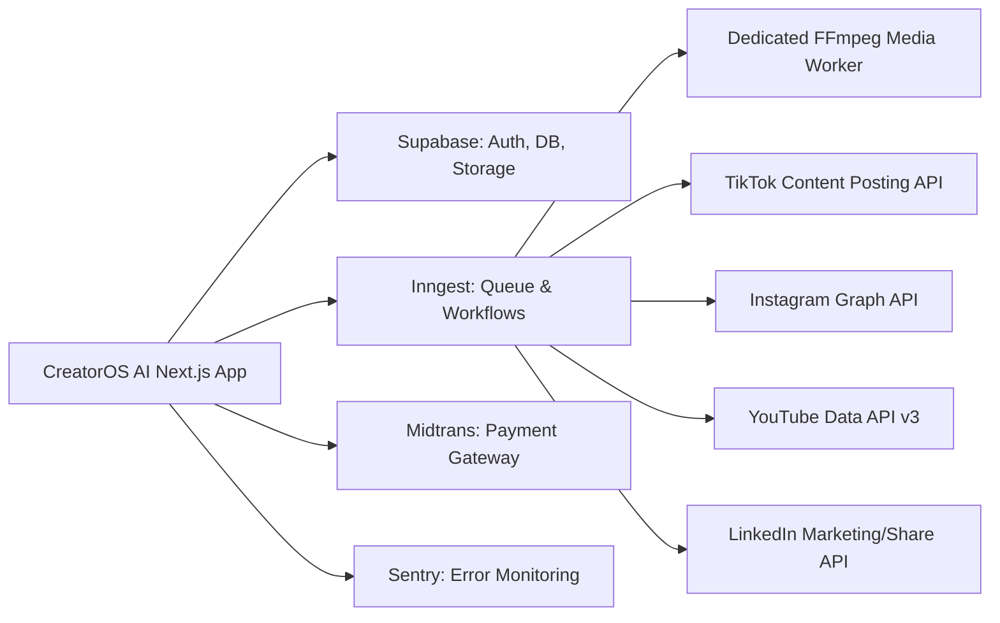

# EXTERNAL INTEGRATIONS ARCHITECTURE — CREATOROS AI

## 1. INTEGRATION LANDSCAPE OVERVIEW

---

## 2. SUPABASE INTEGRATION

### 2.1 Services Utilized
- **Supabase Auth:** JWT-based session management, magic links, email/password, social login.
- **Supabase Database:** PostgreSQL 15+ with connection pooling (Supavisor) on port 6543 (transaction) and port 5432 (session).
- **Supabase Storage:** Buckets for user assets, thumbnails, generated images, and voiceover audio files.
  - Bucket `media-assets`: Private bucket with signed URL access.
  - Bucket `public-avatars`: Public bucket for user and brand logos.
- **Row Level Security (RLS):** Database-native multi-tenant isolation.

### 2.2 Client Architecture
- Browser Client: `createBrowserClient` from `@supabase/ssr`.
- Server Component / Action Client: `createServerClient` reading and writing secure cookies.
- Admin Client: Dedicated utility using `SUPABASE_SERVICE_ROLE_KEY`, restricted to server-side background handlers and webhooks.

---

## 3. INNGEST BACKGROUND PROCESSING

### 3.1 Role & Responsibilities
Inngest serves as the durable execution engine for long-running, asynchronous, or multi-step operations:
- Multi-step AI research pipelines.
- Asynchronous video scene rendering and audio stitching.
- Social media publishing scheduling and automatic retry upon platform throttling.
- Nightly analytics synchronization.

### 3.2 Event-Driven Architecture
- `creatoros/research.requested`: Dispatches `ResearchAgent` background run.
- `creatoros/media.render.requested`: Triggers FFmpeg media worker job.
- `creatoros/publishing.scheduled`: Handles time-based release of scheduled posts.
- `creatoros/billing.subscription.synced`: Handles recurring billing checks.

---

## 4. MIDTRANS PAYMENT GATEWAY (INDONESIA FIRST)

### 4.1 Payment Methods Supported
- **QRIS:** Instant QR code payment supported by BCA, Mandiri, GoPay, OVO, Dana.
- **Virtual Accounts (Bank Transfer):** BCA, Mandiri, BNI, BRI, Permata.
- **E-Wallets:** GoPay, ShopeePay.
- **Credit Cards:** Visa, Mastercard, JCB with 3D-Secure verification.

### 4.2 Webhook Verification & Idempotency
- Incoming notification webhook endpoint: `/api/webhooks/midtrans`.
- Webhook signature verification:
  `SHA512(order_id + status_code + gross_amount + ServerKey)`
- Database transactions use idempotency keys to ensure duplicate webhook notifications do not trigger double-crediting.

---

## 5. SOCIAL MEDIA PUBLISHING APIS

### 5.1 Platform Specifications
| Platform | API Name | Supported Media Formats | OAuth Scope Requirements |
| :--- | :--- | :--- | :--- |
| **TikTok** | TikTok Content Posting API | MP4 (9:16 vertical), WebM | `video.upload`, `video.publish` |
| **Instagram** | Instagram Graph API | MP4 (Reels 9:16), JPG/PNG (Feed) | `instagram_basic`, `instagram_content_publish` |
| **YouTube** | YouTube Data API v3 | MP4 (Shorts 9:16 & Long 16:9) | `https://www.googleapis.com/auth/youtube.upload` |
| **LinkedIn** | LinkedIn Share API | Text, Image, Video (1:1, 16:9) | `w_member_social`, `openid`, `profile` |

### 5.2 Token Refresh & Expiry Handling
- Access tokens and refresh tokens are encrypted at rest using AES-GCM-256 before insertion into `social_accounts`.
- Scheduled cron tasks check for tokens expiring within 48 hours and refresh them automatically.

---

## 6. EXTERNAL MEDIA WORKER (FFmpeg)

- **Architecture:** Node/Go worker deployed on compute-optimized instance (e.g. Docker container).
- **Communication:** Triggered via Inngest or signed HTTP webhooks.
- **Capabilities:**
  - Concatenating video clips with transitions.
  - Adding audio tracks (voiceover + background music with ducking).
  - Burning dynamic subtitles (ASS/SRT format) with synchronized animations.
  - Exporting final renders directly to Supabase Storage.
