# IMPLEMENTATION ROADMAP — CREATOROS AI

## 1. PHASE OVERVIEW & EXECUTION STRATEGY

CreatorOS AI adheres to a strict phase-gated execution plan. Each phase builds upon verified, tested, and fully functional capabilities from previous milestones. Unfinished features are never faked.

```mermaid
flowchart LR
    P1[Phase 1: Foundation & Design System] --> P2[Phase 2: Creator Intelligence]
    P2 --> P3[Phase 3: Research & Strategy]
    P3 --> P4[Phase 4: Content Creation Engine]
    P4 --> P5[Phase 5: Content Production Studio]
    P5 --> P6[Phase 6: Publishing & Calendar]
    P6 --> P7[Phase 7: Analytics Intelligence]
    P7 --> P8[Phase 8: Agent Workspace]
    P8 --> P9[Phase 9: Monetization & SaaS Billing]
    P9 --> P10[Phase 10: Production Launch]
```

---

## 2. DETAILED PHASE SPECIFICATIONS

### Phase 1: Foundation & Design System (CURRENT BASELINE)
- **Goal:** Production-grade application foundation, authentication, multi-tenant workspace isolation, design system, and dashboard shell.
- **Deliverables:**
  - Next.js App Router setup with strict TypeScript.
  - Tailwind CSS + shadcn/ui design tokens for Dark/Light mode.
  - Full suite of accessible UI primitives (buttons, inputs, dialogs, cards, tables, skeletons, toasts).
  - Supabase Auth integration (Sign Up, Sign In, Sign Out, Password Reset, session persistence).
  - Multi-tenant workspace engine (user profiles, workspace membership, RBAC, switching).
  - Initial database migrations with enforced PostgreSQL Row Level Security (RLS).
  - Complete dashboard layout shell with responsive sidebar, workspace switcher, and theme toggle.
  - Functional Settings module (Profile, Account, Workspace, Theme).
  - Unit and integration tests (Vitest) validating authorization and workspace isolation.

### Phase 2: Creator Intelligence & Onboarding
- **Goal:** Onboard creators dynamically, synthesize Creator DNA, and establish 30-day growth roadmaps.
- **Deliverables:**
  - Conversational AI onboarding interview.
  - Creator DNA profile generator (Tone, archetype, strengths, taboo topics).
  - Niche Discovery & evaluation algorithm.
  - Audience Persona generator.
  - 30-day milestone roadmap generator.

### Phase 3: Research Intelligence & Content Strategy
- **Goal:** Empower creators with verified market trends and structured content strategy.
- **Deliverables:**
  - Real-time trend discovery engine.
  - Competitor profile & hook analyzer.
  - Source-backed research dossier generator (with zero fabricated statistics).
  - Content pillar matrix builder & multi-platform distribution strategy.

### Phase 4: Content Creation Engine
- **Goal:** Generate viral hooks, high-retention scripts, and platform-adapted captions.
- **Deliverables:**
  - Categorized idea generator (Curiosity, Contrarian, Step-by-Step, Story).
  - Hook studio with proven psychological opening frameworks.
  - Scriptwriter Studio with timing, pacing, and audio cues (AIDA, PAS).
  - Platform-specific caption and hashtag generator.

### Phase 5: Content Production Studio
- **Goal:** Visual planning and multimedia asset generation.
- **Deliverables:**
  - Scene-by-scene storyboard generator.
  - Image generation provider adapter (thumbnails and graphics).
  - Voiceover studio with natural speech synthesis (ElevenLabs).
  - Background FFmpeg video worker pipeline for rendering and subtitle burning.

### Phase 6: Publishing Center & Editorial Calendar
- **Goal:** Unified scheduling and automated publishing across social channels.
- **Deliverables:**
  - Social OAuth connections (TikTok, Instagram, YouTube, LinkedIn).
  - Drag-and-drop editorial content calendar.
  - Team approval workflow (Draft -> Review -> Approved -> Scheduled).
  - Inngest scheduled publishing dispatchers with error retries.

### Phase 7: Analytics Intelligence & Retrospective Optimization
- **Goal:** Close the loop between content performance and future strategy.
- **Deliverables:**
  - Platform metrics synchronization and retention curves.
  - AI Content Diagnostics engine (identifying what worked and what didn't).
  - Automated recommendations loop updating Creator Intelligence.

### Phase 8: AI Agent Workspace & Multi-Agent Orchestration
- **Goal:** Full visibility and control over autonomous creator agents.
- **Deliverables:**
  - Real-time agent monitoring dashboard.
  - Execution history, session logs, and intermediate thought traces.
  - Hard token caps, cost tracking, and human-in-the-loop approval triggers.

### Phase 9: Monetization Hub & SaaS Billing
- **Goal:** Commercial monetization and subscription billing.
- **Deliverables:**
  - Affiliate product recommendation engine.
  - Digital product funnel builder.
  - Midtrans payment gateway integration (QRIS, GoPay, Bank Transfer).
  - Subscription management and credit wallet metering.

### Phase 10: Production Hardening & Global Launch
- **Goal:** Enterprise security, performance benchmarks, and launch readiness.
- **Deliverables:**
  - End-to-end stress testing and rate-limit verification.
  - Comprehensive security penetration audit and dependency scans.
  - Sentry exception monitoring and uptime health checks.
  - Full Indonesian and English documentation.
