# IMPLEMENTATION ROADMAP — CREATOROS AI

## 1. PHASE OVERVIEW & EXECUTION STRATEGY

CreatorOS AI adheres to a strict phase-gated execution plan. Each phase builds upon verified, tested, and fully functional capabilities from previous milestones. Unfinished features are never faked.

```mermaid
flowchart LR
    P1[Phase 1: Foundation & Design System] --> P2[Phase 2: Creator Intelligence]
    P2 --> P3[Phase 3: Research & Strategy]
    P3 --> P4[Phase 4: Content Creation Engine]
    P4 --> P5[Phase 5: Content Production Studio]
    P5 --> P6[Phase 6: Publishing & Calendar]
    P6 --> P7[Phase 7: Analytics Intelligence]
    P7 --> P8[Phase 8: Agent Workspace]
    P8 --> P9[Phase 9: Monetization & SaaS Billing]
    P9 --> P10[Phase 10: Production Launch]
```

---

## 2. DETAILED PHASE SPECIFICATIONS

### Phase 1: Foundation & Design System (COMPLETED)
- **Goal:** Production-grade application foundation, authentication, multi-tenant workspace isolation, design system, and dashboard shell.
- **Deliverables:**
  - Next.js App Router setup with strict TypeScript.
  - Tailwind CSS + shadcn/ui design tokens for Dark/Light mode.
  - Full suite of accessible UI primitives (buttons, inputs, dialogs, cards, tables, skeletons, toasts).
  - Supabase Auth integration (Sign Up, Sign In, Sign Out, Password Reset, session persistence).
  - Multi-tenant workspace engine (user profiles, workspace membership, RBAC, switching).
  - Initial database migrations with enforced PostgreSQL Row Level Security (RLS).
  - Complete dashboard layout shell with responsive sidebar, workspace switcher, and theme toggle.
  - Functional Settings module (Profile, Account, Workspace, Theme).
  - Unit and integration tests (Vitest) validating authorization and workspace isolation.

### Phase 2: Creator Intelligence & Onboarding (COMPLETED)
- **Goal:** Onboard creators dynamically, synthesize Creator DNA, and establish 30-day growth roadmaps.
- **Deliverables:**
  - Adaptive AI onboarding interview (9 core attributes + dynamic follow-up questions + editable answers).
  - Synthesized & directly editable Creator DNA profile (Tone, UVP, archetype, strengths, taboo topics, platforms, formats).
  - Structured Niche Discovery & evaluation engine with preferred niche selection.
  - Audience Persona generator, Creator Readiness Assessment, and realistic Monetization Recommendations (zero income/virality promises).
  - Interactive 30-day milestone roadmap generator with persistent task tracking, reusable cross-module AI context, and atomic token/credit telemetry.

### Phase 3: Research, Strategy & Content Engine (COMPLETED)
- **Goal:** Empower creators with verified source-backed research, editable content strategy pillars, and platform-native content generation & adaptation.
- **Deliverables:**
  - Trend, Competitor, and Audience Research dossiers (`/trends`, `/competitors`) with recorded `research_sources`, UTC `retrieved_at` timestamps, traceable `trend_claims`, separated `verified_facts` vs `ai_interpretations`, and transparent `realtime_unavailable_reason` reporting.
  - Brand Context, Content Positioning, Opportunity Scoring, and user-editable Content Pillars (`/strategy`).
  - Multi-angle Idea Generator with persistent backlog & editing (`/ideas`).
  - Script Studio (`/studio/scripts`) generating and saving editable hooks, versioned scripts (`PAS`, `AIDA`, `BAB`, `Story`, `Listicle`), captions, CTAs, tiered hashtags, and native cross-platform adaptation (`tiktok`, `instagram`, `youtube`, `linkedin`, `threads`, `x`) with full AI usage & credit metering.

### Phase 4: AI Production Studio (COMPLETED)
- **Goal:** Build an end-to-end multi-tenant content production environment that converts scripts into production-ready media with real files, previews, and timeline editing.
- **Deliverables:**
  - **Storyboard Studio (`/studio/storyboard`):** Visual theme, scene breakdowns, shot types, duration, visual directions, voiceover script, subtitles, and transition cues.
  - **Image Studio (`/studio/images`):** Aspect ratios (`1:1`, `9:16`, `16:9`, `4:5`), styles, negative prompts, prompt enhancement, and real W3C PNG generation (`PngGenerator`).
  - **Voice Studio (`/studio/voice`):** Persona and language selection (Indonesian and English), preview players, pitch/speed controls, audio downloads, and real RIFF/WAVE PCM synthesis (`WavGenerator`).
  - **Subtitle Studio (`/studio/subtitles`):** Automatic cue alignment, word-level segmentation, interactive editor, and multi-format export (`.srt`, `.vtt`, `.json`).
  - **Video Generation (`/studio/video`):** Provider-independent text-to-video / image-to-video, scene generation, job polling, retry logic, and fallback ISO-BMFF MPEG-4 container synthesis (`VideoSynthesizer`).
  - **Video Timeline Editor (`/studio/timeline`):** Non-destructive multi-track editing (video, audio, subtitle, overlay), clip splitting, trimming, drag-and-drop sequencing, text overlays, and canvas preview.
  - **Export Center (`/studio/export`):** Resolution & format selection (`1080p`, `4k`, `mp4`, `webm`), bitrate presets, background rendering jobs, credit deduction, and direct download links.
  - **Asynchronous Worker & Streaming API:** Background media processing worker (`MediaWorkerService`), durable job states (`queued` -> `processing` -> `completed`/`failed`/`retrying`), range-request streaming route (`/api/media/[id]`), and job polling (`/api/workspace/jobs`).
  - **Database & Security:** 4 new tables (`storyboards`, `media_assets`, `generation_jobs`, `video_projects`) with 100% RLS coverage and cross-tenant isolation.
  - **Testing & Verification:** 71 passing tests across 14 test suites, 0 TypeScript errors (`tsc --noEmit`).

### Phase 5: AI Agent & Automation (COMPLETED — CURRENT BASELINE)
- **Goal:** Implement the coordinated AI agent ecosystem, durable multi-agent orchestration DAGs, human approval gates, and cron-based workflow automation.
- **Deliverables:**
  - **10 Specialized Agents:** Typed input and output schemas, defined responsibilities, status tracking, logging, cost accounting, retry policies, and timeouts (Orchestrator, Researcher, Strategist, Idea Generator, Scriptwriter, Storyboard, Designer, Producer, Analyst, Monetization Coach).
  - **Multi-Step Coordinated Workflows:**
    - Workflow A: Research → Strategy → Idea → Script → Storyboard (with human approval gate).
    - Workflow B: Product Research → Product Positioning → Affiliate Script → Video Brief.
    - Workflow C: Performance Data → Analysis → Recommendations → New Content Strategy.
  - **Human-in-the-Loop Controls:** Pause workflow, request approval, inspect agent outputs, resume workflow, and cancel workflow.
  - **Automation & Scheduling:** Cron expression calculation, scheduled background runner, and strict limit of maximum 5 autonomous turns per task (no runaway agent loops).
  - **Interactive Agent Workspace (`/agents`):** Real-time workflow launcher, visual DAG timeline, approval dialog modal, inspectable log viewer, and schedule manager.
  - **Database & Security:** 4 new PostgreSQL tables (`workflow_runs`, `workflow_steps`, `workflow_schedules`, `workflow_logs`) with 100% RLS tenant isolation and 5 atomic stored procedures (`advance_workflow_step`, `approve_workflow_step`, `pause_workflow_run`, `resume_workflow_run`, `cancel_workflow_run`).
  - **Testing & Verification:** 108/108 tests passing across 20 test files, 5/5 PostgreSQL audits passed, 0 TypeScript errors.

### Phase 6: Publishing Center & Editorial Calendar
- **Goal:** Unified scheduling and automated publishing across social channels.
- **Deliverables:**
  - Social OAuth connections (TikTok, Instagram, YouTube, LinkedIn).
  - Drag-and-drop editorial content calendar.
  - Team approval workflow (Draft -> Review -> Approved -> Scheduled).
  - Inngest scheduled publishing dispatchers with error retries.

### Phase 7: Analytics Intelligence & Retrospective Optimization
- **Goal:** Close the loop between content performance and future strategy.
- **Deliverables:**
  - Platform metrics synchronization and retention curves.
  - AI Content Diagnostics engine (identifying what worked and what didn't).
  - Automated recommendations loop updating Creator Intelligence.

### Phase 8: AI Agent Workspace & Multi-Agent Orchestration
- **Goal:** Full visibility and control over autonomous creator agents.
- **Deliverables:**
  - Real-time agent monitoring dashboard.
  - Execution history, session logs, and intermediate thought traces.
  - Hard token caps, cost tracking, and human-in-the-loop approval triggers.

### Phase 9: Monetization Hub & SaaS Billing
- **Goal:** Commercial monetization and subscription billing.
- **Deliverables:**
  - Affiliate product recommendation engine.
  - Digital product funnel builder.
  - Midtrans payment gateway integration (QRIS, GoPay, Bank Transfer).
  - Subscription management and credit wallet metering.

### Phase 10: Production Hardening & Global Launch
- **Goal:** Enterprise security, performance benchmarks, and launch readiness.
- **Deliverables:**
  - End-to-end stress testing and rate-limit verification.
  - Comprehensive security penetration audit and dependency scans.
  - Sentry exception monitoring and uptime health checks.
  - Full Indonesian and English documentation.
