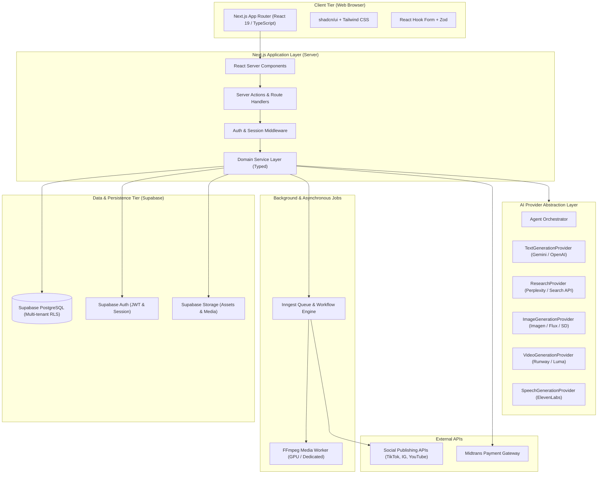

# SYSTEM ARCHITECTURE DOCUMENT — CREATOROS AI

## 1. ARCHITECTURAL OVERVIEW & PHILOSOPHY

CreatorOS AI is designed as a **Modular Monolith** optimized for developer velocity, operational simplicity, and rigorous tenant isolation. Rather than prematurely fragmenting services into microservices, the system maintains high cohesion and low coupling through strict internal boundaries, typed service layers, and provider abstractions.

---

## 2. APPLICATION LAYERING & BOUNDARIES

### 2.1 Presentation Layer (`src/components/`, `src/app/`)
- Server Components by default for zero client bundle bloat and fast data fetching.
- Client Components (`"use client"`) strictly reserved for interactive forms, rich canvas/timeline interactions, and client-side reactive state.
- Zero direct database queries in UI components; all interactions flow through Server Actions or typed Service Layer methods.

### 2.2 Domain Service Layer (`src/services/`)
- Pure TypeScript business logic classes or modules.
- Responsible for validating domain rules, orchestrating database transactions, checking user credit quotas, and invoking AI provider abstractions.
- Every service method accepts an execution context: `{ user: UserSession, workspaceId: string }`.

### 2.3 Provider Abstraction Layer (`src/lib/ai/`)
- Employs Dependency Inversion (SOLID). Domain services interact exclusively with abstract provider interfaces.
- Concrete adapters encapsulate vendor-specific SDK quirks, schema transformations, rate-limit retry logic, and token cost calculation.
- Supported providers can be swapped dynamically or configured with automatic fallback policies.

### 2.4 Asynchronous Worker Tier (`src/inngest/` & Dedicated Worker)
- **Inngest:** Handles durable, serverless-friendly tasks (agent research workflows, long-running script generation chains, social posting retries, scheduled dispatches).
- **Media Worker:** Standalone Node/Go/Python worker with FFmpeg installed on a dedicated compute instance (or serverless GPU container) for video rendering, stitching, waveform generation, and subtitle burning.

---

## 3. MULTI-TENANCY & DATA ISOLATION ARCHITECTURE

Multi-tenancy in CreatorOS AI is rooted in the `workspaces` table:
1. Every user has a default personal workspace created upon registration.
2. Users can create or join additional workspaces (e.g., agency workspaces, team accounts).
3. Access rights are determined by `workspace_members`:
   - `owner`: Full control, billing management, workspace deletion.
   - `admin`: Member invitations, API key management, workspace settings.
   - `editor`: Create, edit, and publish content items.
   - `viewer`: Read-only access to strategy, calendars, and analytics.
4. Supabase Row Level Security (RLS) is enforced at the database engine level, ensuring that even if application-level bugs occur, PostgreSQL refuses cross-tenant data leaks.

---

## 4. ERROR HANDLING & OBSERVABILITY

1. **Structured Error Hierarchy:**
   - `AppError`: Base application error with standard error codes and HTTP status mappings.
   - `ValidationError`: Zod validation failures.
   - `AuthorizationError`: Workspace or permission rejections.
   - `ProviderError`: AI or external integration failures with retry metadata.
   - `InsufficientCreditsError`: Quota and credit exhaustion.
2. **Sentry Integration:** Client and server exception tracking with scrubbed PII.
3. **Usage & Audit Logging:** Persistent telemetry in `ai_provider_usage` and `audit_logs`.
